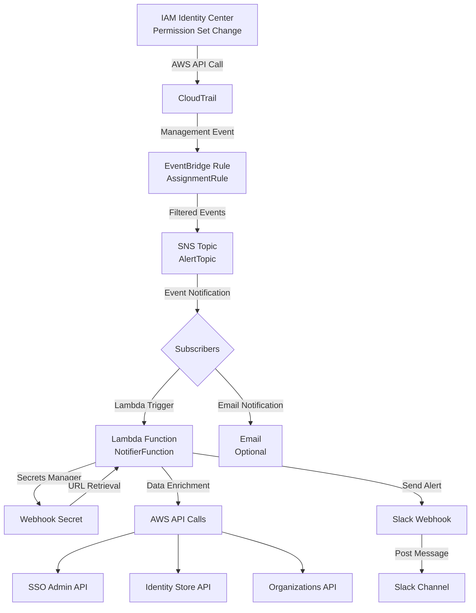
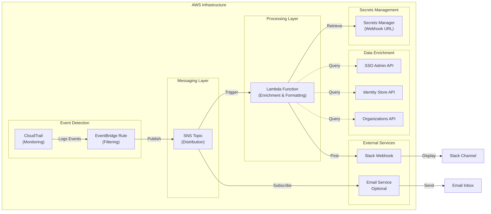
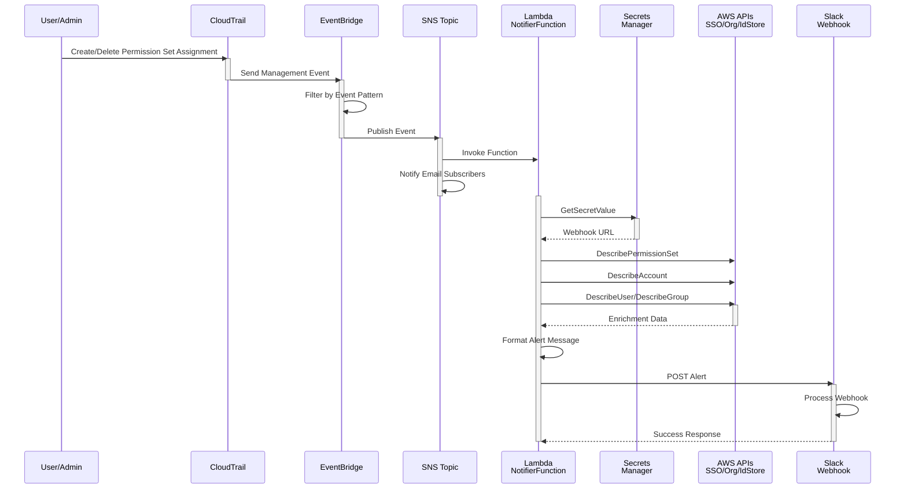
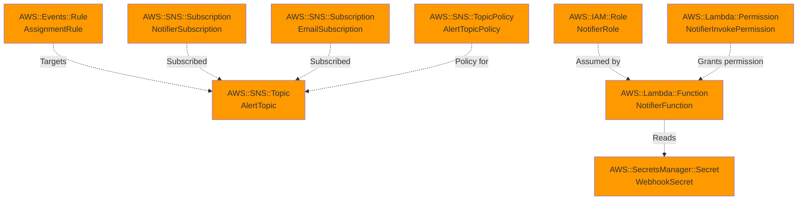

# SSO Permission Set Alerts

Alerts to Slack when specific IAM Identity Center permission sets are assigned or unassigned to an account, or when any permission set is assigned or unassigned to the management account or configured Control Tower audit and log archive accounts. Deploy in the AWS Management account in the region where IAM Identity Center is enabled (its "home" region).

## Overview

This CloudFormation template creates an automated monitoring solution that watches for changes to AWS IAM Identity Center (formerly AWS SSO) permission set assignments. When a specified permission set is assigned to or removed from an account, or any permission set targets the management account or a configured Control Tower account, an alert is sent to Slack with detailed information about the action.

The EventBridge rule matches either a permission set in `PermissionSetArns` or a target account ID equal to the management, audit, or log archive account. Management-account monitoring uses the stack's `AWS::AccountId`. A Lambda-backed CloudFormation custom resource discovers the Control Tower accounts from the landing-zone manifest: `securityRoles.accountId` for audit and `centralizedLogging.accountId` for log archive. These accounts' permission sets do not need to be listed in `PermissionSetArns`. An event matching both criteria is routed once by the rule (delivery retries can still occur). `AlertOnRemoval` controls removal alerts for all monitored accounts and permission sets; failed API calls remain excluded.

Leave `AuditAccountId` and `LogArchiveAccountId` empty for automatic discovery, or supply either as an override. Supplying both skips Control Tower API calls. Set `ControlTowerHomeRegion` if Control Tower's home region differs from the stack's Identity Center region. Missing or invalid discovered IDs, disabled manifest features, and API errors fail the stack operation explicitly rather than silently dropping monitoring. For landing zones without those features, provide explicit account IDs.

Discovery runs on stack creation and when the custom resource's properties change. It is not continuous and does not run on unrelated stack updates. Change `DiscoveryRefreshToken` to a new value (for example, a date or revision) to force discovery on an update. The resolved IDs are exposed as stack outputs. Deleting the stack does not query or modify Control Tower.

### Key Features

- 🔒 **Real-time Monitoring**: Detects permission set assignments and removals instantly
- 📧 **Multi-channel Alerts**: Sends notifications to Slack and optionally to email
- 🔍 **Rich Context**: Enriches alerts with permission set names, account names, and user details
- ⚙️ **Configurable**: Customize which permission sets to monitor
- 🏢 **Management Account Monitoring**: Alert on any permission set targeting the management account, regardless of the configured permission set list
- **Control Tower Account Monitoring**: Automatically discover the audit and log archive accounts and alert on any permission set targeting them, with optional manual ID overrides
- 🎛️ **Flexible Removal Alerts**: Optional alerting on permission set removal events

## Architecture

### System Flow



### Component Architecture



### Data Flow Diagram



## Deployment

### Prerequisites

- AWS Management account access
- IAM Identity Center enabled in a specific region
- A Control Tower landing zone with audit and centralized logging accounts, or explicit overrides for both account IDs
- Permission sets already created in Identity Center
- Slack workspace with incoming webhook access
- Appropriate IAM permissions to create CloudFormation stacks

### Parameters

| Parameter | Type | Default | Description |
|-----------|------|---------|-------------|
| `PermissionSetArns` | List | Required | Comma-separated permission set ARNs to monitor across all accounts. Any permission set targeting the management account or configured Control Tower accounts is also monitored. Example: `arn:aws:sso:::permissionSet/ssoins-1234567890abcdef/ps-0123456789abcdef` |
| `AuditAccountId` | String | Empty | Optional 12-digit audit account ID override. Empty means discover from Control Tower. |
| `LogArchiveAccountId` | String | Empty | Optional 12-digit log archive account ID override. Empty means discover from Control Tower. |
| `ControlTowerHomeRegion` | String | Empty | Region used for Control Tower discovery. Empty means the stack region. |
| `DiscoveryRefreshToken` | String | Empty | Change to a new value on a stack update to rerun discovery. |
| `SlackWebhookUrl` | String | Required | Slack incoming webhook URL (stored securely in Secrets Manager). Get one from your Slack app's Incoming Webhooks settings. |
| `AlertOnRemoval` | String | `true` | Set to `true` to also alert when permission sets are removed; `false` to alert only on assignments. |
| `NotificationEmail` | String | Empty | Optional email address to also subscribe to SNS notifications. |

### Deployment Steps

1. **Get your Slack Webhook URL**:
   - Navigate to https://api.slack.com/apps
   - Select your app (or create a new one)
   - Enable Incoming Webhooks
   - Add a new webhook and copy the URL

2. **Get your Permission Set ARNs**:
   ```bash
   aws sso-admin list-permission-sets \
     --instance-arn arn:aws:sso:::instance/ssoins-XXXXXXXXX \
     --region us-east-1
   ```

3. **Deploy the CloudFormation Stack**:
   ```bash
   aws cloudformation create-stack \
     --stack-name sso-permset-alerts \
     --template-body file://sso-permset-alerts.yaml \
     --parameters \
       ParameterKey=PermissionSetArns,ParameterValue="arn:aws:sso:::permissionSet/ssoins-XXXX/ps-YYYY,arn:aws:sso:::permissionSet/ssoins-XXXX/ps-ZZZZ" \
       ParameterKey=SlackWebhookUrl,ParameterValue="https://hooks.slack.com/services/YOUR/WEBHOOK/URL" \
       ParameterKey=AlertOnRemoval,ParameterValue="true" \
       ParameterKey=NotificationEmail,ParameterValue="admin@example.com" \
     --capabilities CAPABILITY_NAMED_IAM \
     --region us-east-1
   ```

   The example discovers both Control Tower account IDs automatically in `us-east-1`. If Control Tower has a different home region, supply `ControlTowerHomeRegion`. To override discovery, supply `AuditAccountId` and/or `LogArchiveAccountId`.

   For an existing stack, update it with the modified template. Existing nonempty account ID parameters remain overrides; explicitly set them to empty strings to switch to discovery.

4. **Verify Deployment**:
   ```bash
   aws cloudformation describe-stacks \
     --stack-name sso-permset-alerts \
     --region us-east-1
   ```

## Resources Created

### AWS Services



| Resource | Type | Purpose |
|----------|------|---------|
| `WebhookSecret` | Secrets Manager | Securely stores the Slack webhook URL |
| `AlertTopic` | SNS Topic | Central hub for distributing alerts |
| `AlertTopicPolicy` | IAM Policy | Grants EventBridge permission to publish to SNS |
| `EmailSubscription` | SNS Subscription | Optional email notifications (conditional) |
| `AccountDiscoveryRole` | IAM Role | Allows the discovery Lambda to list landing zones and read the management account's landing-zone manifest |
| `AccountDiscoveryFunction` | Lambda Function | Resolves audit and log archive IDs from overrides or Control Tower |
| `ControlTowerAccounts` | Custom Resource | Supplies resolved account IDs to the EventBridge rule and stack outputs |
| `AssignmentRule` | EventBridge Rule | Filters CloudTrail events for watched permission sets across all accounts or any permission set targeting the management or configured Control Tower accounts |
| `NotifierRole` | IAM Role | Execution role for Lambda function |
| `NotifierFunction` | Lambda Function | Enriches and formats alerts, posts to Slack |
| `NotifierInvokePermission` | Lambda Permission | Grants SNS permission to invoke Lambda |
| `NotifierSubscription` | SNS Subscription | Triggers Lambda when alerts are published |

## Lambda Function Details

### Environment Variables

- `SECRET_ARN`: ARN of the Secrets Manager secret containing the Slack webhook URL

### IAM Permissions

The notifier Lambda function requires the following permissions:

```json
{
  "Version": "2012-10-17",
  "Statement": [
    {
      "Effect": "Allow",
      "Action": "secretsmanager:GetSecretValue",
      "Resource": "arn:aws:secretsmanager:*:*:secret:*"
    },
    {
      "Effect": "Allow",
      "Action": [
        "sso:ListInstances",
        "sso:DescribePermissionSet",
        "identitystore:DescribeUser",
        "identitystore:DescribeGroup",
        "organizations:DescribeAccount"
      ],
      "Resource": "*"
    }
  ]
}
```

The separate discovery Lambda requires `controltower:ListLandingZones` on `*` and `controltower:GetLandingZone` on landing zones in the management account, plus basic Lambda logging permissions. It does not modify Control Tower or Organizations resources.

### Data Enrichment

The Lambda function enriches alerts with:

- **Permission Set Name**: From SSO Admin API
- **Account Name**: From Organizations API
- **Principal Name**: From Identity Store API (user username or group display name)
- **Identity Store ID**: Derived from SSO instances
- **Management Account Details**: From Organizations API

### Alert Message Format

Slack alerts include:

```
🔒 Highly Privileged Permission Set ASSIGNED
Management account: [account-name] ([account-id])
SSO instance: [instance-arn] (identity store: [store-id])
Permission set: [permission-set-name]
Account: [target-account-name] ([target-account-id])
Principal: [user-name-or-group] ([type])
By: [actor-arn]
Source IP: [source-ip]
Time: [event-time]
```

## Monitoring & Troubleshooting

### View Lambda Logs

```bash
aws logs tail /aws/lambda/sso-permset-alerts --follow
```

### Common Issues

| Issue | Cause | Solution |
|-------|-------|----------|
| Alerts not appearing in Slack | Invalid webhook URL | Verify webhook URL in Secrets Manager |
| Lambda execution failures | Missing IAM permissions | Check Lambda execution role permissions |
| Permission set name shows "?" | Insufficient permissions | Verify SSO Admin API permissions |
| User/Group name shows "?" | Identity Store API errors | Check identity store configuration |
| No events detected | EventBridge rule not matching | Verify permission set ARNs match exactly, or that the target account is the management account or a configured audit/log archive account |
| Stack fails during account discovery | Wrong Control Tower region, missing permissions, or missing/disabled manifest features | Check the custom resource failure reason and discovery Lambda logs; set `ControlTowerHomeRegion` or explicit account ID overrides |

### Testing

Local validation uses `cfn-lint` and its Python dependencies. The unit tests execute the inline discovery Lambda with SDK-stubbed responses; no AWS credentials or network calls are required:

```powershell
cfn-lint .\sso-permset-alerts.yaml
python -B -m unittest discover -s .\tests -v
```

After updating the stack, verify the following using actual assignment events in the Identity Center home region:

| Permission set | Target account | Expected alert |
|----------------|----------------|----------------|
| In `PermissionSetArns` | Other member account | Yes |
| Not in `PermissionSetArns` | Management account | Yes |
| In `PermissionSetArns` | Management account | Yes, routed once by the rule |
| Not in `PermissionSetArns` | Discovered or overridden audit account | Yes |
| Not in `PermissionSetArns` | Discovered or overridden log archive account | Yes |
| In `PermissionSetArns` | Discovered or overridden audit or log archive account | Yes, routed once by the rule |
| Not in `PermissionSetArns` | Other member account | No |

Repeat with removal events: matching removals alert only when `AlertOnRemoval=true`. Failed API calls do not alert. Direct Lambda invocation tests formatting and delivery only; it bypasses EventBridge filtering.

Manually invoke the Lambda function to test:

```bash
aws lambda invoke \
  --function-name sso-permset-alerts-NotifierFunction-XXXXX \
  --payload '{"Records":[{"Sns":{"Message":"{\"detail\":{\"eventName\":\"CreateAccountAssignment\",\"requestParameters\":{\"permissionSetArn\":\"arn:aws:sso:::permissionSet/ssoins-XXXX/ps-YYYY\",\"instanceArn\":\"arn:aws:sso:::instance/ssoins-XXXX\",\"targetId\":\"123456789012\",\"principalType\":\"USER\",\"principalId\":\"test-user-id\"},\"recipientAccountId\":\"111111111111\",\"sourceIPAddress\":\"1.2.3.4\",\"eventTime\":\"2024-01-15T10:30:00Z\",\"userIdentity\":{\"arn\":\"arn:aws:iam::111111111111:user/admin\"}}}"}}]}' \
  response.json

cat response.json
```

## Cost Estimation

This solution uses the following AWS services:

- **CloudTrail**: Pay per CloudTrail event (very low cost)
- **EventBridge**: $0.35 per million events
- **SNS**: Free tier includes 1M publishes per month
- **Lambda**: Free tier includes 1M invocations per month
- **Secrets Manager**: $0.40 per secret per month
- **Identity Center**: Existing cost (not added by this solution)

**Estimated Monthly Cost**: < $1 USD (for low-volume permission set assignments)

## Security Best Practices

1. **Webhook URL Storage**: The Slack webhook URL is stored in AWS Secrets Manager with encryption at rest
2. **IAM Least Privilege**: Lambda only has permissions to read necessary AWS APIs
3. **CloudTrail Logging**: All API calls are logged in CloudTrail for audit trail
4. **Event Filtering**: EventBridge includes watched permission sets across all accounts and all permission sets targeting the management or configured Control Tower accounts
5. **Audit Trail**: All permission set changes are tracked with source IP and timestamp

### Additional Security Recommendations

- Enable encryption on the SNS topic
- Use VPC endpoints for private connectivity to AWS services
- Enable MFA for Slack webhook rotation
- Regularly audit CloudTrail logs for suspicious activity
- Implement resource policies to restrict SNS topic access
- Consider rotating the Slack webhook URL periodically

## Cleanup

To remove all resources created by this stack:

```bash
aws cloudformation delete-stack \
  --stack-name sso-permset-alerts \
  --region us-east-1

# Wait for stack deletion to complete
aws cloudformation wait stack-delete-complete \
  --stack-name sso-permset-alerts \
  --region us-east-1
```

## Support & Contributing

For issues, questions, or contributions, please refer to the project's issue tracker or documentation.

## License

This solution is provided as-is. Modify and use as needed for your AWS environment.

---

**Last Updated**: November 2026  
**Template Version**: 2010-09-09  
**Tested With**: Python 3.12, AWS Lambda
